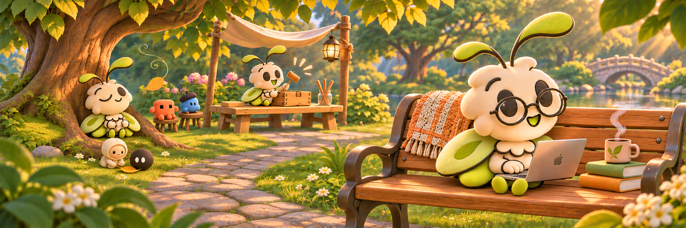

## Hey, I’m Nag 👋

I’m Nagarjuna Boddu. I work in software, and I like following a good “what if?”

🛠️ I’m building tools to explore videos and saved ideas, experiments in memory across conversations, and little animated companions. I’m drawn to useful things with a bit of personality.

🔎 I’m also exploring local AI, smoother developer workflows, and ways to make separate tools work well together. The quiet details interest me too: what happens when something fails, or an answer isn’t quite complete.

🤓 I’m curious, talkative, and happy to get very geeky about the details. The glasses come out for deep work. Sometimes it’s a system I’m figuring out; sometimes it’s whether a tiny character’s eyes feel right.

🌱 That little moth is a bit of me: building, wondering, taking a breather, then coming back with another idea. I want the things I make to be useful—and give someone a small reason to smile.

Some experiments are already here. Others are still on the workbench. I’ll share more as they’re ready.

Glad you wandered in.
