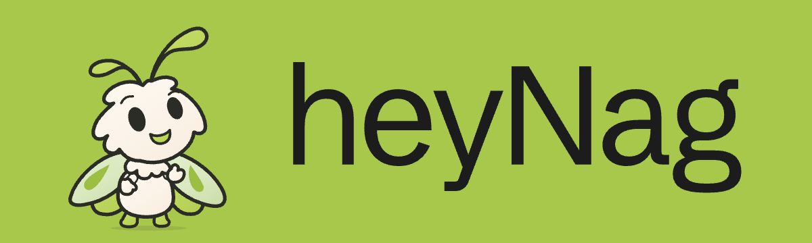

<picture>
  <source media="(prefers-color-scheme: dark)" srcset="assets/brand/header-v5-dark.png">
  <source media="(prefers-color-scheme: light)" srcset="assets/brand/header-v5-light.png">
  
</picture>

## Hey, I'm Nag.

I build software and the systems around it. I'm drawn to useful tools, curious experiments, and the small details that make software feel good.

Most of my work lives in private repositories. Here's a small public window into what I'm making.

### Things I've shared

**[Charms](https://github.com/heyNag/charms)** — Plugins that help coding agents understand videos and work with saved X posts. A few extra ways to look closely.

**[Grok Bot](https://github.com/heyNag/codex-pet-grok-bot)** — An unofficial animated companion for Codex, with expressive movement and light and dark editions. An experiment in giving software a little personality.

**[eva.md](https://github.com/heyNag/eva-md)** — Memory for Claude Code and Codex, kept in Markdown and Git. An evolving experiment in picking up where the last session left off.

---

Exploring ideas worth keeping.
